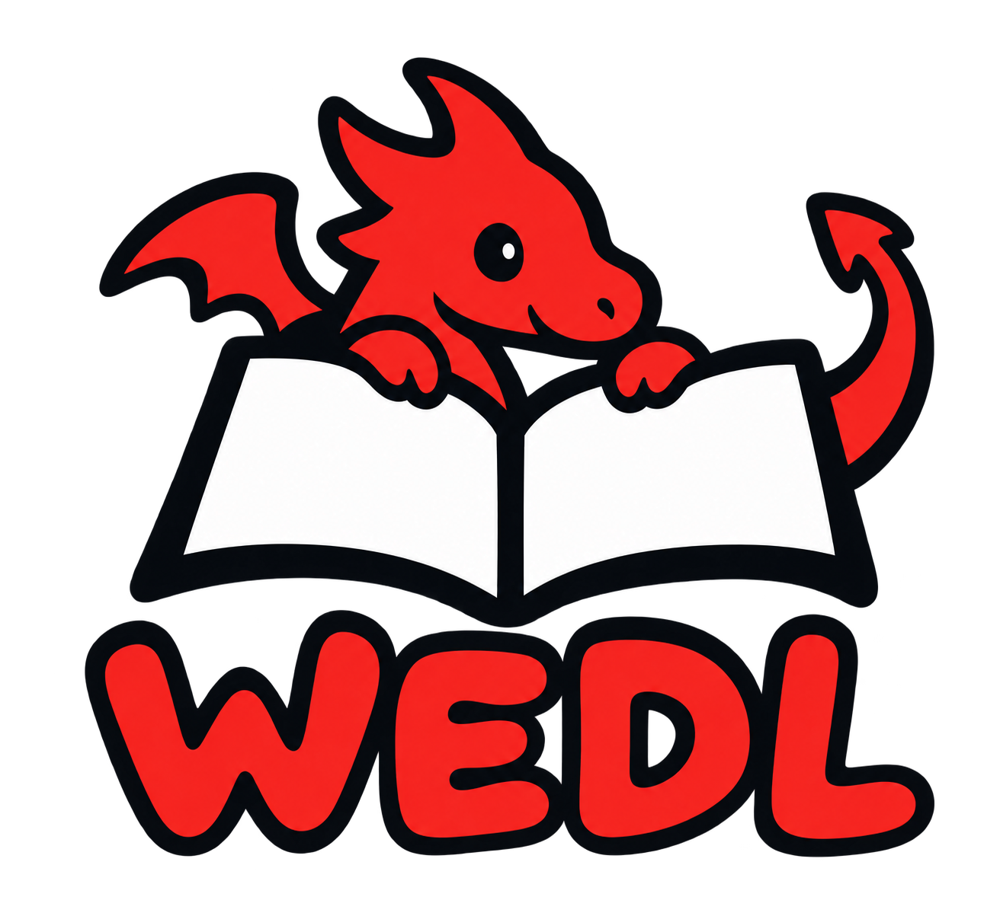

WEDL is a Rust tool for building, querying, and browsing story worlds stored in Markdown.

## Create a blank world

```sh
wedl-rs init my-world --title "My World"
```

## Start from an example

From the project directory, copy the included Tideglass world to a new folder.

```sh
cp -R examples/tideglass tideglass-world
```

## Explore a world

```sh
wedl-rs --repo tideglass-world status
wedl-rs --repo tideglass-world validate
wedl-rs --repo tideglass-world search ferry
wedl-rs --repo tideglass-world serve
```

After running `serve`, open [localhost:8765](http://127.0.0.1:8765) in your browser.
The browser is read-only by default. Use `serve --live-author` to enable
reviewed publication in the current worktree.
